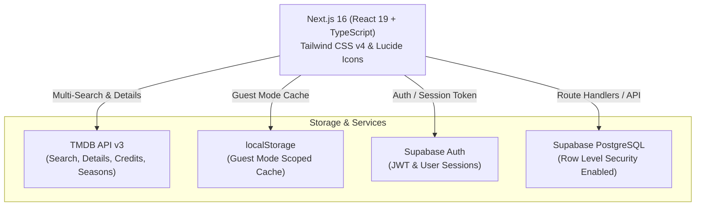

<div align="center">

# 🛋️ COUCH CRITICS
### *Your Personal Cinema & TV Show Journal*

<p align="center">
  <strong>Track your watch progress, curate your backlog, and reflect on your cinematic journey.</strong><br>
  <em>"Every movie you watch, you are making part of you."</em>
</p>

[](https://nextjs.org/)
[](https://react.dev/)
[](https://www.typescriptlang.org/)
[](https://tailwindcss.com/)
[](https://www.themoviedb.org/)
[](https://supabase.com/)

</div>

---

## 📖 Table of Contents
- [What is Couch Critics?](#-what-is-couch-critics)
  - [The Concept of the "Couch Critic"](#the-concept-of-the-couch-critic)
  - [The Core Philosophy](#the-core-philosophy)
- [Why Couch Critics?](#-why-couch-critics)
- [Comprehensive Feature Overview](#-comprehensive-feature-overview)
  - [1. The Three-Shelf Lifecycle](#1-the-three-shelf-lifecycle)
  - [2. Episode-Level TV & Movie Progress Tracker](#2-episode-level-tv--movie-progress-tracker)
  - [3. Real-Time TMDB Search & Offline Snapshots](#3-real-time-tmdb-search--offline-snapshots)
  - [4. Streaming & OTT Hub ("Where to Watch")](#4-streaming--ott-hub-where-to-watch)
  - [5. Private Reviews & Personal Journal](#5-private-reviews--personal-journal)
  - [6. Deep Analytics & Statistics Dashboard](#6-deep-analytics--statistics-dashboard)
  - [7. Journey Timeline & Favorites Shelf](#7-journey-timeline--favorites-shelf)
  - [8. "Pick What to Watch" Choosing Panel](#8-pick-what-to-watch-choosing-panel)
  - [9. Midnight Cinema Design & Theme Engine](#9-midnight-cinema-design--theme-engine)
  - [10. Dual Mode: Guest Mode & Cloud Sync](#10-dual-mode-guest-mode--cloud-sync)
- [Architecture & Tech Stack](#-architecture--tech-stack)
- [Data Model & Security](#-data-model--security)
- [Getting Started](#-getting-started)
  - [Prerequisites](#prerequisites)
  - [Installation](#installation)
  - [Environment Variables](#environment-variables)
  - [Running the App](#running-the-app)
- [Project Structure](#-project-structure)
- [License & Acknowledgments](#-license--acknowledgments)

---

## 🍿 What is Couch Critics?

**Couch Critics** is a modern, private-first web application designed for passionate film and television viewers. It serves as your personal media archive, allowing you to catalog every movie, series, documentary, and anime you're watching, plan to watch, or have completed—all enriched with episode progress tracking, personal reviews, streaming availability, and rich visual metrics.

### The Concept of the "Couch Critic"
A **couch critic** (or armchair critic) is an everyday media enthusiast who watches and critiques films and shows from the comfort of their living room sofa. Unlike red-carpet press reviewers or professional festival critics, couch critics evaluate stories through a genuine, relatable lens: *Did it entertain me? Did it move me? Was it worth my time? Would I rewatch it?* 

**Couch Critics** was created to give home viewers a dedicated space built specifically around their personal relationship with film and television.

### The Core Philosophy
> *"Every movie you watch, you are making part of you."*

Most media platforms today are designed around social algorithms, performative rating battles, or recommendation feeds pushed by streaming networks. **Couch Critics is different:**
- **Private-First**: Your ratings, reviews, and logs are yours alone. Rate a guilty pleasure 10/10 without social judgment.
- **Platform-Agnostic**: One unified library whether you watched on Netflix, Prime Video, Apple TV+, Disney+, in a movie theater, or on physical 4K Blu-ray.
- **Cinematic Experience**: Designed like an elegant, dimly lit cinema hall—rich poster walls, warm ambient glows, and glassmorphic stat cards instead of bland spreadsheets.

---

## 💡 Why Couch Critics?

| The Problem with Traditional Trackers | How Couch Critics Solves It |
|---|---|
| **Scattered viewing history** across 5+ streaming apps | **One central journal** for all media across every OTT platform |
| **Losing track of TV series progress** across breaks and seasons | **Episode-level season trackers** with quick `+1` increment and episode history |
| **Social review pressure** (performative reviews for likes) | **Private journal entries** with personal notes, custom tags, and honest 1–10 scores |
| **No insight into personal viewing habits** | **Dynamic Analytics Dashboard** tracking total watch time, genre distribution, and rating patterns |
| **Analysis paralysis** ("What should I watch tonight?") | **Choosing Panel modal** with media showcase and quick shelf actions |

---

## ✨ Comprehensive Feature Overview

### 1. The Three-Shelf Lifecycle
The core organization of Couch Critics mirrors how human viewers naturally organize media using a predictable state machine:

```
[TMDB Search / Showcase]
         │
         ├──► 📋 Want to Watch (Backlog & Wishlist)
         │           │
         │           ▼
         └──► ⏳ Watching (Active Progress)
                     │
                     ▼
              🏆 Watched (Completed Archive + Private Review)
```

* **📋 Want to Watch (To Watch Shelf)**:
  * Your personal cinematic queue and backlog.
  * Tagged with release year, runtime, and streaming providers.
  * Quick transitions to *Watching* or directly to *Watched*.
* **⏳ Watching (Currently Watching Shelf)**:
  * In-progress movies and ongoing TV series.
  * Dynamic visual progress bars calculating completion percentage.
  * Instant episode stepping controls.
* **🏆 Watched (Completed Archive)**:
  * Your permanent portfolio of finished titles.
  * Displays personal ratings (1–10 scale), tags, completion timestamps, and rewatch indicators.
  * Searchable and filterable by genre, year, rating, and media type.

---

### 2. Episode-Level TV & Movie Progress Tracker
* **TV Show Granular Tracking**:
  * Tracks `currentSeason` and `currentEpisode` against `totalEpisodes` and `totalSeasons`.
  * Fetches TMDB season episode counts automatically.
  * One-tap `+1 Episode` quick action directly from the shelf cards.
  * Formatted episode history logs (`S1E1`, `S1E2`) with timestamps.
* **Movie Runtime Tracking**:
  * Tracks current minute elapsed (`minutesWatched` vs `totalMinutes`).
  * Helpful when pausing long films midway through.

---

### 3. Real-Time TMDB Search & Offline Snapshots
* **Debounced Multi-Search**: 400ms debounced search querying The Movie Database (TMDB) across both movies and TV shows simultaneously.
* **Rich Metadata Auto-Fill**:
  * Original and localized titles, release year, runtime, overview, director/creators, cast, and genres.
  * High-resolution posters (`w500`) and cinematic backdrops (`original`).
* **Offline Snapshotting**: When an item is added, a complete snapshot of TMDB metadata is frozen in your journal. Titles remain fully visible, browsable, and editable even without an active internet connection.

---

### 4. Streaming & OTT Hub ("Where to Watch")
* **Integrated Streaming Registry**: Built-in support for major streaming and OTT networks (Netflix, Amazon Prime Video, Disney+, Apple TV+, Max, Hulu, Paramount+, Peacock, and more).
* **Instant Provider Badges**: Instantly see where any title is streaming with official brand colors and icons.
* **Filter by OTT Platform**: Quickly narrow down your backlog by what is currently available on your subscribed services.

---

### 5. Private Reviews & Personal Journal
* **Granular 1–10 Rating System**: Rate titles with precision (including half-star / decimal ratings).
* **Reflective Journal Notes**: Free-form markdown-friendly personal reflections—capture how a movie made you feel, who you watched it with, or favorite quotes.
* **Custom Tags**: Categorize with your own taxonomy (e.g., `#comfort-watch`, `#mind-bending`, `#directors-cut`, `#rainy-day`, `#tearjerker`).
* **Rewatch Tracking**: Mark titles as rewatches and log rewatch counts.
* **Completion Dates**: Preserves the exact ISO date and time you finished watching.

---

### 6. Deep Analytics & Statistics Dashboard
Computed fresh from your viewing entries on-the-fly:
* **Total Watch Time**: Real-time summation of hours, formatted into human-readable `Xd Xh Xm` (days, hours, minutes).
* **Movie vs. TV Split**: Compare total time spent on feature films versus television series.
* **Average Rating & Score Distribution**: Mean user rating with visual histograms across the 1–10 score spectrum.
* **Genre Breakdown**: Interactive charts ranking your most-watched genres (Drama, Sci-Fi, Crime, Animation, etc.).
* **Viewing Velocity**: Monthly timeline metrics (`YYYY-MM`) showcasing your viewing habits across the year.

---

### 7. Journey Timeline & Favorites Shelf
* **🗺️ Cinematic Journey**: A chronological visual retrospective grouped by year of completion. Trace your taste evolution from year to year.
* **❤️ Curated Favorites**: An automatic showcase filter for all masterpieces rated 8.0/10 or higher.

---

### 8. "Pick What to Watch" Choosing Panel
* **Interactive Media Showcase**: Marquee carousel displaying featured and trending cinema.
* **Quick-Decider Modal**: Fast shelf assignment, synopsis preview, and streaming options to eliminate decision fatigue.

---

### 9. Midnight Cinema Design & Theme Engine
* **Aesthetic**: Styled with a bespoke *Midnight Cinema* color palette (`#0a0a0a` onyx base, warm amber accents `#d97706`, and subtle stone neutrals).
* **Ambient Backdrop**: Dynamic poster backdrop wall displaying randomly shuffled posters from your personal library with smooth vignetting.
* **Interactive Polish**:
  * Glassmorphism cards with backdrop blur.
  * Ambient cursor glow tracking (`GradientCursorTracker.tsx`).
  * Micro-animations and hover transforms.
* **Multi-Theme Support**: Instant toggle between *Midnight Dark* and *Clean Light* modes with zero flicker.

---

### 10. Dual Mode: Guest Mode & Cloud Sync
* **Guest Mode (Zero Setup)**:
  * Works instantly out of the box with `localStorage`.
  * Scoped storage keys (`couch-critics-guest-entries`) prevent data pollution.
  * No sign-in or credit card required.
* **Cloud Sync (Supabase PostgreSQL)**:
  * Seamless authentication via Supabase Auth (Email / Password).
  * Strict PostgreSQL Row Level Security (RLS) ensuring strict per-user data isolation.
  * Cloud backup and cross-device synchronization between your desktop, tablet, and mobile.

---

## 🛠️ Architecture & Tech Stack



| Layer | Technology | Purpose |
|---|---|---|
| **Framework** | [Next.js 16](https://nextjs.org/) (App Router) | Server components, native API route handlers, optimized fonts & images |
| **UI Library** | [React 19](https://react.dev/) | Client-side reactive interface, state transitions, hooks |
| **Language** | [TypeScript 5](https://www.typescriptlang.org/) | Strict end-to-end type safety |
| **Styling** | [Tailwind CSS v4](https://tailwindcss.com/) | Modern CSS utility styling, glassmorphism, responsive cinema grid |
| **Icons** | [Lucide React](https://lucide.dev/) | Consistent, clean iconography |
| **Validation** | [Zod](https://zod.dev/) | Schema validation for API payloads and entry models |
| **Movie Data** | [The Movie Database (TMDB)](https://www.themoviedb.org/) | Worldwide catalog of movies, series, episodes, and artwork |
| **Database & Auth** | [Supabase](https://supabase.com/) | Managed PostgreSQL with Row Level Security (RLS) and JWT auth |

---

## 🗄️ Data Model & Security

### Core Database Entities

* **`profiles`**: User metadata, display names, avatars, and bios. Auto-provisioned on signup.
* **`entries`**: Core media items tagged with `shelf` (`watching` | `toWatch` | `watched`), TMDB snapshot, episode counters, and runtime. Unique constraint on `(user_id, tmdb_id)`.
* **`reviews`**: 1-to-1 attached reviews containing `rating` (1–10), `notes`, `tags[]`, and `dateCompleted`.
* **`attachments`**: Media attachments with signed URLs backed by Supabase Storage.

### Security
* **Row Level Security (RLS)**: Enforced on all PostgreSQL tables. Users can strictly only read and write their own data:
  ```sql
  CREATE POLICY "Users can only manage their own entries"
  ON entries FOR ALL
  USING (auth.uid() = user_id);
  ```

---

## 🚀 Getting Started

### Prerequisites
* **Node.js**: `v20.x` or higher
* **npm**, **pnpm**, or **yarn**
* *(Optional)* A free [TMDB API Key](https://www.themoviedb.org/documentation/api)
* *(Optional)* A free [Supabase Project](https://supabase.com/) for Cloud Sync

### Installation

1. **Clone the repository:**
   ```bash
   git clone https://github.com/nihal-hnm/couch-critics.git
   cd couch-critics
   ```

2. **Install dependencies:**
   ```bash
   npm install
   ```

### Environment Variables

Create a `.env.local` file in the root directory:

```env
# TMDB API (Optional - built-in fallback provided for development)
NEXT_PUBLIC_TMDB_API_KEY=your_tmdb_api_key_here

# Supabase Configuration (Required for Cloud Sync & Auth)
NEXT_PUBLIC_SUPABASE_URL=https://your-project.supabase.co
NEXT_PUBLIC_SUPABASE_ANON_KEY=your-supabase-anon-key

# Server-side Supabase Admin (Required for Route Handlers)
SUPABASE_URL=https://your-project.supabase.co
SUPABASE_ANON_KEY=your-supabase-anon-key
SUPABASE_SERVICE_ROLE_KEY=your-service-role-key
```

### Running the App

Start the development server:

```bash
npm run dev
```

Open [http://localhost:3000](http://localhost:3000) in your browser.

### Available Scripts

| Script | Command | Purpose |
|---|---|---|
| `dev` | `npm run dev` | Runs the Next.js development server with hot reload |
| `build` | `npm run build` | Compiles the production application bundle |
| `start` | `npm run start` | Starts the production server |
| `lint` | `npm run lint` | Runs ESLint to check for code quality and syntax issues |

---

## 📂 Project Structure

```
COUCH/
├── src/
│   ├── app/                      # Next.js 16 App Router
│   │   ├── api/                  # Native Route Handlers (entries, auth, reviews)
│   │   ├── login/                # Authentication page
│   │   ├── globals.css           # Tailwind v4 theme & cinema styling
│   │   ├── layout.tsx            # Root layout with SEO metadata & theme loader
│   │   └── page.tsx              # Application entry point
│   ├── components/               # React UI Components
│   │   ├── AnalyticsDashboard.tsx# Deep viewing analytics & charts
│   │   ├── AuthModal.tsx         # Sign in / Register modal
│   │   ├── ChoosingPanelModal.tsx# "Pick What to Watch" decision assistant
│   │   ├── Dashboard.tsx         # Main cinema layout & navigation tabs
│   │   ├── MediaDetailModal.tsx  # Detailed modal with cast, seasons & review editor
│   │   ├── SearchModal.tsx       # Live TMDB search dialog
│   │   ├── StatsDashboard.tsx    # Summary stats cards
│   │   ├── ThemeToggle.tsx       # Dark/Light theme switcher
│   │   ├── WatchingShelf.tsx     # In-progress episode tracker shelf
│   │   ├── ToWatchShelf.tsx      # Watchlist & backlog shelf
│   │   ├── WatchedShelf.tsx      # Completed journal shelf
│   │   └── common/
│   │       ├── MovieImage.tsx    # Optimized poster component with fallback
│   │       └── WhereToWatch.tsx  # OTT / Streaming provider badge renderer
│   └── lib/                      # Core business logic & utilities
│       ├── journal-context.tsx   # React Context + Reducer state management
│       ├── storage.ts            # Scoped localStorage persistence engine
│       ├── tmdb.ts               # TMDB API client with memory & session caching
│       ├── stats.ts              # Mathematical stats & chart computation
│       ├── streaming-registry.ts # OTT provider directory & styling
│       ├── theme-context.tsx     # Theme state provider
│       └── types.ts              # Single source of truth for TypeScript interfaces
├── backend/                      # Express prototype & Supabase SQL migration files
│   └── db/
│       └── schema.sql            # PostgreSQL table definitions & RLS policies
├── public/                       # Static icons, logos, and favicons
├── prd.md                        # Comprehensive Product Requirements Document
├── PROJECT_STATUS_AND_TODO.md    # Architecture migration log and roadmap
└── package.json                  # Dependencies & project scripts
```

---

## 📄 License & Acknowledgments

- **Data Attribution**: Film and television metadata and imagery provided by [The Movie Database (TMDB)](https://www.themoviedb.org/). This product uses the TMDB API but is not endorsed or certified by TMDB.
- **Icons**: Designed by [Lucide Icons](https://lucide.dev/).
- **Created for**: Movie lovers, television binge-trackers, and couch critics everywhere.
