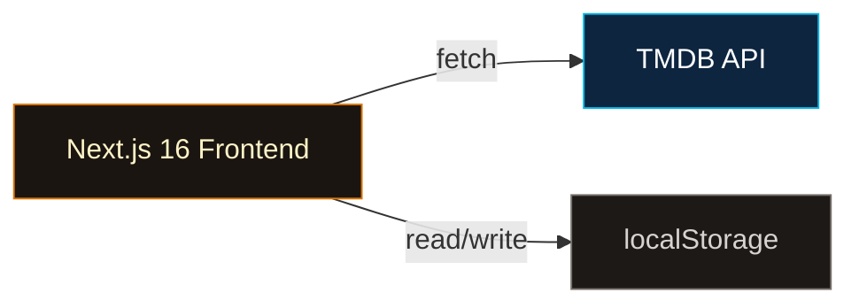
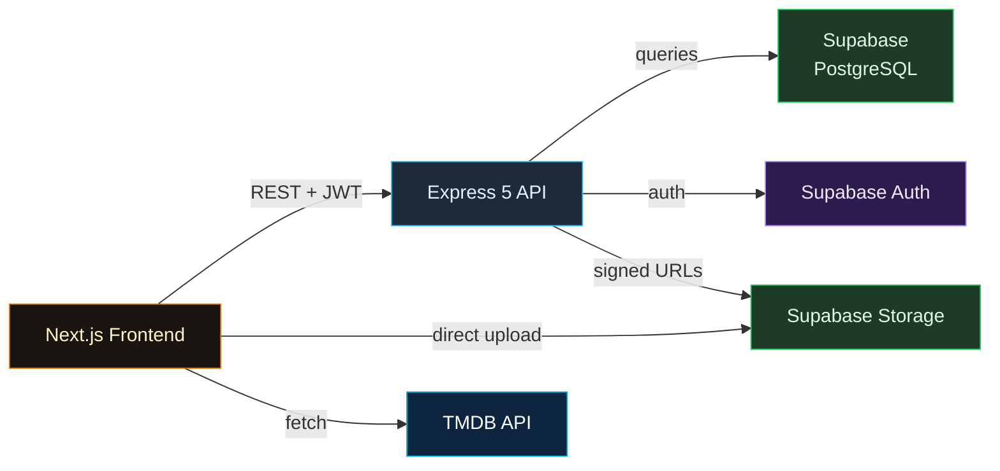
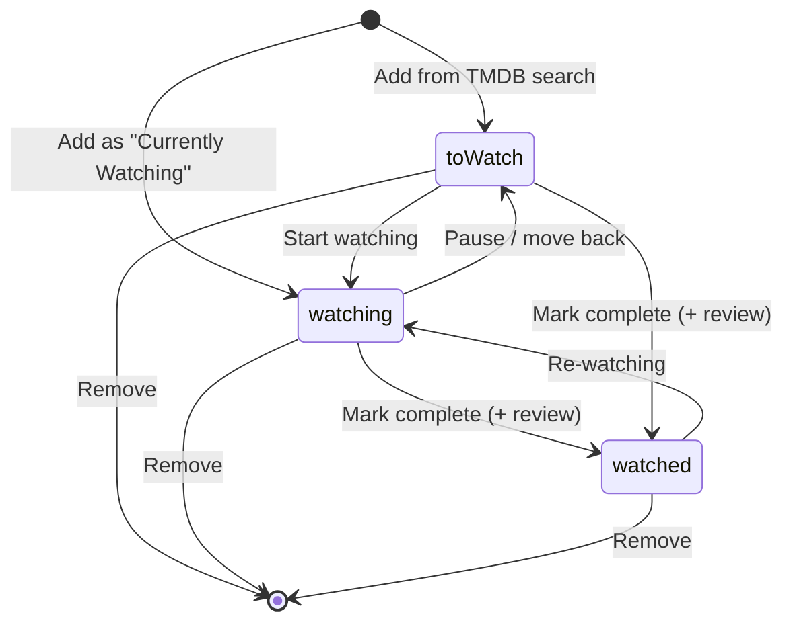
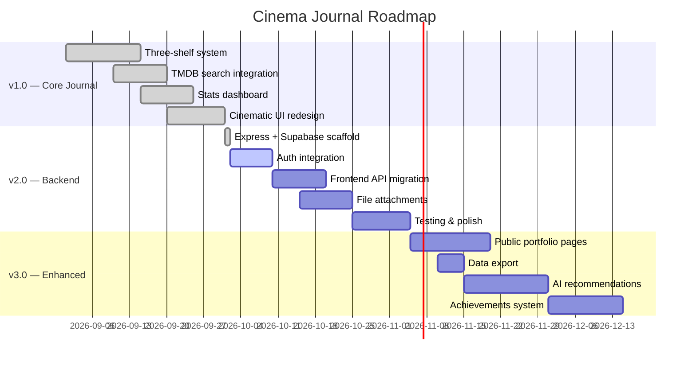

# 🎬 Cinema Journal — Product Requirements Document (PRD)

> **Version:** 1.0  
> **Last Updated:** 2026-10-02  
> **Status:** Draft  
> **Author:** Engineering Team  

---

## 1. Product Vision

**Cinema Journal** is a personal movie and TV show portfolio tracker that lets users catalog every title they're watching, plan to watch, or have completed — and reflect on their viewing journey through ratings, reviews, tags, and visual statistics.

### 1.1 Mission Statement

> *"Every movie you watch, you are making part of you."*

Cinema Journal transforms passive media consumption into an intentional, reflective practice. It is not a social platform or a recommendation engine — it is a **personal archive** designed for the individual who wants to remember, rate, and revisit the stories that shaped them.

### 1.2 Problem Statement

| Problem | Impact |
|---------|--------|
| Viewers forget what they've watched or want to watch | Lost recommendations, repeat viewing, wasted browsing time |
| No unified place for movies + TV shows across services | Content scattered across Netflix, Prime, theaters, etc. |
| Rating/review platforms are social-first, not personal | Users don't write honest reviews when peers can see them |
| No way to visualize personal viewing habits over time | No insight into genre preferences, watch time patterns, or taste evolution |

### 1.3 Value Proposition

- **One journal** for all movies and TV shows regardless of streaming platform
- **Three shelves** that mirror how people naturally think: *Watching*, *Want to Watch*, *Watched*
- **Private-first** — honest ratings and notes with no social pressure
- **Cinematic aesthetic** — the app feels like a love letter to film, not a spreadsheet

---

## 2. Target Users

### 2.1 Primary Persona — "The Intentional Viewer"

| Attribute | Detail |
|-----------|--------|
| **Age Range** | 18–35 |
| **Behavior** | Watches 3–8 movies/shows per month across multiple platforms |
| **Pain Point** | Loses track of recommendations, forgets opinions on past titles |
| **Goal** | A beautiful, private place to organize and reflect on their viewing |
| **Tech Savvy** | Comfortable with modern web apps, values good design |

### 2.2 Secondary Persona — "The Binge Tracker"

| Attribute | Detail |
|-----------|--------|
| **Behavior** | Watches 15+ hours/week, heavily into TV series |
| **Pain Point** | Loses track of which episode they're on across multiple series |
| **Goal** | Episode-level progress tracking with quick shelf transitions |

---

## 3. Architecture Overview

### 3.1 Current State (v1.0 — Shipped)



- **Frontend:** Next.js 16, React 19, TypeScript, Tailwind CSS v4
- **Data:** Client-side localStorage (≈5 MB limit, ≈2,500 entries max)
- **Movie Data:** TMDB API v3 (free key, client-side fetch)
- **State:** React Context + `useReducer` (pure reducer, side effects in effects)

### 3.2 Planned State (v2.0 — In Development)



- **Backend:** Express 5 + TypeScript on Node ≥ 20
- **Database:** Supabase PostgreSQL with RLS on every table
- **Auth:** Supabase Auth (JWT-based, verified server-side via `getUser()`)
- **Storage:** Supabase Storage with signed upload URLs (zero backend bandwidth)
- **Validation:** Zod schemas on all endpoints
- **Error Handling:** Central middleware mapping PostgREST codes to HTTP statuses

---

## 4. Feature Inventory

### 4.1 Navigation Structure

The app uses a **single-page, section-based layout** with 6 navigation tabs:

| Tab | Description | Status |
|-----|-------------|--------|
| 🏠 Home | Hero with poster wall, stat cards, collection/favorites/journey/stats previews | ✅ Shipped |
| 🎬 Movies | Full list of movie entries across all shelves | ✅ Shipped |
| 📺 Series | Full list of TV show entries across all shelves | ✅ Shipped |
| 📊 Stats | Dedicated statistics dashboard with genre charts, watch time, ratings | ✅ Shipped |
| 🗺️ Journey | Timeline grouped by year — chronological viewing history | ✅ Shipped |
| ❤️ Favorites | Top-rated entries (rating ≥ 8), sorted by rating descending | ✅ Shipped |

### 4.2 Core Feature: Three-Shelf System

The foundation of the app is a **state machine** for every entry:



#### Shelf: To Watch
- Purpose: Wishlist / backlog of titles the user intends to watch
- Data: TMDB snapshot only (no progress or review)
- Actions: Move to Watching, Move to Watched, Remove

#### Shelf: Watching
- Purpose: Currently in-progress titles
- Data: TMDB snapshot + progress tracking
- Progress model:
  - **Movies:** `minutesWatched` / `totalMinutes` (progress bar)
  - **TV Shows:** `currentEpisode` / `totalEpisodes` (episode counter)
- Actions: Update progress (± increment), Mark complete (with review prompt), Move back to To Watch, Remove

#### Shelf: Watched
- Purpose: Completed titles with personal review
- Data: TMDB snapshot + review
- Review model:
  - `rating` (1–10 scale)
  - `notes` (free-form text)
  - `tags` (user-created, e.g., "mind-bending", "comfort-watch")
  - `dateCompleted` (ISO date)
- Actions: Edit review, Move to Re-watching, Remove

### 4.3 TMDB Search & Integration

| Feature | Detail |
|---------|--------|
| Search endpoint | TMDB `/search/multi` (movies + TV in one call) |
| Debounced search | 400 ms debounce to prevent API flooding |
| Result filtering | Excludes "person" results, only movies + TV shows |
| Detail fetch | On add, fetches `/movie/{id}` or `/tv/{id}` with `append_to_response=credits` for runtime + director |
| Data snapshot | Full TMDB data is stored locally at add-time for offline access |
| Duplicate prevention | Entries deduplicated by `(user_id, tmdb_id)` unique constraint |
| Genre mapping | Client-side ID → name mapping (28 genres) avoids extra API calls |

### 4.4 Statistics Dashboard

Computed on-the-fly from the entries array (never persisted):

| Metric | Computation |
|--------|-------------|
| Total Watched | Count of entries on "watched" shelf |
| Total Watch Time | Sum of all watched entry runtimes (formatted as `Xd Xh Xm`) |
| Average Rating | Mean of all review ratings (1 decimal place) |
| Favorite Genres | Genre frequency across all entries, sorted descending |
| Watched Per Month | Grouped by `YYYY-MM` from `dateCompleted` |

### 4.5 File Attachments (v2.0)

| Feature | Detail |
|---------|--------|
| Upload flow | Client requests signed upload URL → uploads directly to Supabase Storage → confirms metadata to API |
| Storage structure | `{bucket}/{user_id}/{entry_id}/{filename}` |
| Access control | RLS policies match folder to `auth.uid()` |
| Download | Signed private URLs with configurable expiry (default: 1 hour) |
| Cleanup | On entry deletion, all associated files are batch-deleted |

### 4.6 Hero Section & Visual Design

| Element | Implementation |
|---------|----------------|
| Poster wall backdrop | Up to 8 randomly shuffled posters from the user's collection |
| Gradient overlays | Multi-layer: bottom fade, side vignette, ambient warm glow |
| Stat cards | Movies / Series / Minutes / Average Rating — glassmorphism cards |
| Section previews | Horizontal poster scroll for collection, favorites, journey cards, quick stats |
| Featured movie panel | Highest-rated entry displayed with poster, synopsis, and rating badge |
| Color palette | Dark base (`#0a0a0a`), warm amber/orange accents, stone neutrals |
| Animations | `animate-glow`, hover scale transforms, smooth transitions |

---

## 5. Data Model

### 5.1 Entity Relationship Diagram

```mermaid
erDiagram
    auth_users ||--o| profiles : "auto-created on signup"
    auth_users ||--o{ entries : "owns"
    entries ||--o| reviews : "has (watched shelf only)"
    entries ||--o{ attachments : "has files"

    profiles {
        UUID id PK "FK → auth.users"
        TEXT username UK
        TEXT display_name
        TEXT avatar_url
        TEXT bio
        TIMESTAMPTZ created_at
        TIMESTAMPTZ updated_at
    }

    entries {
        UUID id PK
        UUID user_id FK "→ auth.users, CASCADE"
        TEXT shelf "CHECK: watching|toWatch|watched"
        INT tmdb_id "UNIQUE(user_id, tmdb_id)"
        TEXT title
        TEXT poster_url
        TEXT release_year
        INT runtime
        TEXT_ARRAY genres
        TEXT director
        TEXT overview
        TEXT media_type "CHECK: movie|tv"
        INT current_episode
        INT total_episodes
        INT minutes_watched
        INT total_minutes
        TIMESTAMPTZ created_at
        TIMESTAMPTZ updated_at
    }

    reviews {
        UUID id PK
        UUID entry_id FK_UK "→ entries, CASCADE"
        UUID user_id FK "→ auth.users, CASCADE"
        SMALLINT rating "CHECK: 1–10"
        TEXT notes
        TEXT_ARRAY tags
        DATE date_completed
        TIMESTAMPTZ created_at
        TIMESTAMPTZ updated_at
    }

    attachments {
        UUID id PK
        UUID entry_id FK "→ entries, CASCADE"
        UUID user_id FK "→ auth.users, CASCADE"
        TEXT bucket
        TEXT storage_path
        TEXT file_name
        TEXT content_type
        BIGINT size_bytes
        TIMESTAMPTZ created_at
    }
```

### 5.2 Row Level Security (RLS) Summary

| Table | SELECT | INSERT | UPDATE | DELETE |
|-------|--------|--------|--------|--------|
| profiles | Any authenticated user | Auto (trigger) | Own row only | N/A (CASCADE) |
| entries | Own rows only | Own rows only | Own rows only | Own rows only |
| reviews | Own rows only | Own rows only | Own rows only | Own rows only |
| attachments | Own rows only | Own rows only | N/A | Own rows only |
| storage.objects | Own folder only | Own folder only | Own folder only | Own folder only |

### 5.3 Frontend Data Model (Current — localStorage)

| Type | Purpose |
|------|---------|
| `MovieEntry` | Core entity: `id`, `shelf`, `tmdb` (snapshot), `progress?`, `review?`, `addedAt`, `updatedAt` |
| `TMDBMovieData` | TMDB snapshot: `tmdbId`, `title`, `posterUrl`, `releaseYear`, `runtime`, `genres`, `director`, `overview`, `mediaType` |
| `WatchProgress` | `currentEpisode?`, `totalEpisodes?`, `minutesWatched?`, `totalMinutes?` |
| `UserReview` | `rating` (1–10), `notes`, `tags[]`, `dateCompleted` |
| `Shelf` | Union type: `"watching" | "toWatch" | "watched"` |

---

## 6. User Stories

### Epic 1: Core Journaling (v1.0 ✅)

| ID | Story | Acceptance Criteria |
|----|-------|-------------------|
| CJ-01 | As a viewer, I want to search for movies and TV shows by title so I can add them to my journal | Debounced TMDB search returns results within 1s; shows poster, title, year, media type |
| CJ-02 | As a viewer, I want to add a title to my To Watch shelf so I can track my backlog | One-click add from search results; duplicate detection by TMDB ID; success feedback |
| CJ-03 | As a viewer, I want to move a title from To Watch → Watching so I can track my progress | Shelf transition updates state immediately; progress controls become available |
| CJ-04 | As a viewer, I want to track my viewing progress on the Watching shelf | Movies: minute-based slider; TV: episode counter with ±1 controls |
| CJ-05 | As a viewer, I want to mark a title as Watched and write a review | Review form: 1–10 rating, text notes, custom tags, completion date |
| CJ-06 | As a viewer, I want to see my viewing statistics at a glance | Stats dashboard: total watched, watch time, average rating, genre breakdown, monthly chart |
| CJ-07 | As a viewer, I want to browse my viewing journey as a timeline | Entries grouped by year with poster thumbnails |
| CJ-08 | As a viewer, I want to see my favorites (highest rated titles) in one place | Auto-curated: entries with rating ≥ 8, sorted by rating desc |
| CJ-09 | As a viewer, I want to filter between Movies and Series views | Nav tabs filter by `mediaType === "movie"` or `"tv"` |
| CJ-10 | As a viewer, I want my data to persist across browser sessions | localStorage with auto-save on every state change |

### Epic 2: Backend Migration (v2.0 🔧)

| ID | Story | Acceptance Criteria |
|----|-------|-------------------|
| CJ-11 | As a user, I want to create an account so my data syncs across devices | Supabase Auth: email/password + OAuth (Google, GitHub) |
| CJ-12 | As a user, I want my journal entries stored in a database, not localStorage | All CRUD operations go through Express API → Supabase PostgreSQL |
| CJ-13 | As a user, I want only I can see my journal entries | RLS policies enforce `auth.uid() = user_id` on every table |
| CJ-14 | As a user, I want to upload screenshots or notes to an entry | Signed upload URLs → direct Supabase Storage upload; metadata saved to `attachments` table |
| CJ-15 | As a user, I want my uploaded files to be private and secure | Storage bucket RLS: folder-based ownership matching `auth.uid()` |
| CJ-16 | As a user, I want clear error messages when something goes wrong | PostgREST error codes mapped to human-readable HTTP responses |
| CJ-17 | As a user, I want a profile with my display name and avatar | Auto-created on signup from auth metadata; editable via API |

### Epic 3: Enhanced Experience (v3.0 🔮 — Future)

| ID | Story | Acceptance Criteria |
|----|-------|-------------------|
| CJ-18 | As a user, I want to share my favorites as a public portfolio page | Optional public profile with curated favorites list |
| CJ-19 | As a user, I want to export my journal data as JSON or CSV | One-click export from settings |
| CJ-20 | As a user, I want AI-powered movie recommendations based on my taste | Analyze genre/rating patterns → suggest similar titles via TMDB |
| CJ-21 | As a user, I want to see viewing streaks and achievements | Gamification: "Watched 10 in a month", "Genre Explorer", etc. |
| CJ-22 | As a user, I want "Pick for Tonight" — random suggestion from my To Watch list with filters | Filter by genre, runtime, mood; weighted random selection |

---

## 7. API Specification (v2.0)

### 7.1 Endpoint Table

| Method | Path | Auth | Request Body | Response |
|--------|------|------|-------------|----------|
| `GET` | `/api/health` | ❌ | — | `{ status, timestamp, uptime }` |
| `GET` | `/api/entries?shelf=` | ✅ | — | `{ data: Entry[] }` |
| `GET` | `/api/entries/:id` | ✅ | — | `{ data: Entry & { review, attachments } }` |
| `POST` | `/api/entries` | ✅ | `CreateEntrySchema` | `{ data: Entry }` (201) |
| `PATCH` | `/api/entries/:id` | ✅ | `UpdateEntrySchema` | `{ data: Entry }` |
| `DELETE` | `/api/entries/:id` | ✅ | — | 204 No Content |
| `PATCH` | `/api/entries/:id/shelf` | ✅ | `MoveToShelfSchema` | `{ data: Entry }` |
| `POST` | `/api/entries/:id/upload-url` | ✅ | `{ fileName }` | `{ data: { signedUrl, token, path } }` |
| `POST` | `/api/entries/:id/download-url` | ✅ | `{ storagePath }` | `{ data: { signedUrl } }` |

### 7.2 Error Response Format

```json
{
  "error": {
    "message": "This movie is already in your journal",
    "code": "23505",
    "statusCode": 409
  }
}
```

---

## 8. Non-Functional Requirements

| Category | Requirement | Target |
|----------|-------------|--------|
| **Performance** | Time to Interactive | < 2 seconds on 4G |
| **Performance** | API response time (p95) | < 200 ms |
| **Performance** | Stats computation (1,000 entries) | < 5 ms |
| **Scalability** | Entries per user | Up to 10,000 |
| **Scalability** | Concurrent users | 1,000+ (Supabase managed) |
| **Security** | Auth | JWT verified server-side (not just decoded) |
| **Security** | Data isolation | RLS on 100% of tables |
| **Security** | File access | Signed URLs with 1-hour expiry |
| **Security** | Input validation | Zod schemas on all endpoints |
| **Reliability** | Data persistence | PostgreSQL with Supabase backups |
| **Accessibility** | ARIA compliance | `role="tablist"`, `aria-selected`, `aria-label` on all interactive elements |
| **Browser Support** | Modern browsers | Chrome 90+, Firefox 90+, Safari 15+, Edge 90+ |
| **Mobile** | Responsive design | Fully usable on 375px+ viewports |

---

## 9. Risk Analysis

| Risk | Severity | Likelihood | Mitigation |
|------|----------|-----------|------------|
| TMDB API rate limiting | Medium | Medium | Client-side debouncing (400ms), cache TMDB snapshots on add |
| TMDB API key exposure in client bundle | Low | High | Key is free/rate-limited; document that sensitive keys must use `NEXT_PUBLIC_` only for safe keys |
| localStorage data loss (browser clear) | High | Medium | v2.0 migration to Supabase PostgreSQL eliminates this |
| Supabase service outage | Medium | Low | Health check endpoint for monitoring; graceful error messages |
| RLS policy bypass | Critical | Low | Service role key restricted to server-side only; admin client never exposed to requests |
| File storage abuse (large uploads) | Medium | Low | Storage bucket size limits; validate file types server-side |

---

## 10. Success Metrics

| Metric | Target (6 months post-v2.0) | Measurement |
|--------|------------------------------|-------------|
| Monthly Active Users | 500+ | Supabase Auth analytics |
| Entries per Active User | 20+ | Database query |
| User Retention (30-day) | 40%+ | Auth session tracking |
| API Error Rate | < 1% | Error handler logging |
| Average Session Duration | > 3 minutes | Frontend analytics |

---

## 11. Milestones & Roadmap



---

## 12. Tech Stack Summary

| Layer | Technology | Version |
|-------|-----------|---------|
| Frontend Framework | Next.js | 16.3.8 |
| UI Library | React | 19.2.8 |
| Styling | Tailwind CSS | v4 |
| Icons | Lucide React | 1.49.0 |
| Language | TypeScript | 5.x |
| Backend Framework | Express | 5.1.0 |
| Database | PostgreSQL (Supabase) | 15+ |
| Auth | Supabase Auth | JS v2 |
| File Storage | Supabase Storage | JS v2 |
| Validation | Zod | 3.25.x |
| Movie Data | TMDB API | v3 |
| Dev Runtime | tsx (ESBuild) | 4.19.x |
| Security | Helmet + CORS | Latest |

---

## Appendix A: Key File References

| File | Purpose |
|------|---------|
| [`types.ts`](file:///c:/Users/harsh/.gemini/antigravity-ide/cinema-journal/src/lib/types.ts) | Frontend type definitions (MovieEntry, Shelf, etc.) |
| [`journal-context.tsx`](file:///c:/Users/harsh/.gemini/antigravity-ide/cinema-journal/src/lib/journal-context.tsx) | React Context + useReducer state management |
| [`tmdb.ts`](file:///c:/Users/harsh/.gemini/antigravity-ide/cinema-journal/src/lib/tmdb.ts) | TMDB API service (search, detail fetch) |
| [`storage.ts`](file:///c:/Users/harsh/.gemini/antigravity-ide/cinema-journal/src/lib/storage.ts) | localStorage persistence layer |
| [`stats.ts`](file:///c:/Users/harsh/.gemini/antigravity-ide/cinema-journal/src/lib/stats.ts) | Statistics computation (pure functions) |
| [`Dashboard.tsx`](file:///c:/Users/harsh/.gemini/antigravity-ide/cinema-journal/src/components/Dashboard.tsx) | Main dashboard with hero, nav, all sections |
| [`SearchModal.tsx`](file:///c:/Users/harsh/.gemini/antigravity-ide/cinema-journal/src/components/SearchModal.tsx) | TMDB search modal with debounced input |
| [`WatchingShelf.tsx`](file:///c:/Users/harsh/.gemini/antigravity-ide/cinema-journal/src/components/WatchingShelf.tsx) | Watching shelf with progress tracking |
| [`schema.sql`](file:///c:/Users/harsh/.gemini/antigravity-ide/cinema-journal/backend/db/schema.sql) | Complete SQL migration for v2.0 |
| [`server.ts`](file:///c:/Users/harsh/.gemini/antigravity-ide/cinema-journal/backend/src/server.ts) | Express API entry point |
